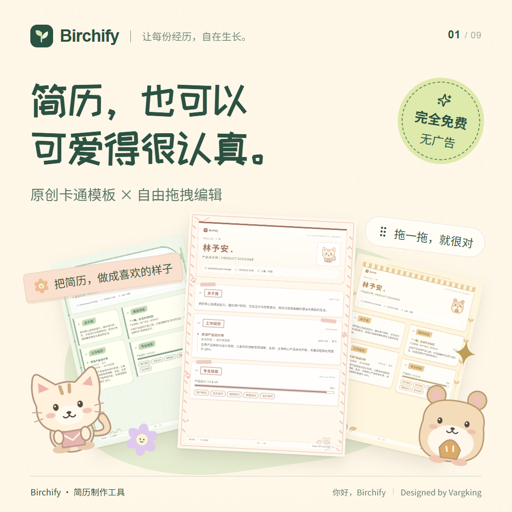
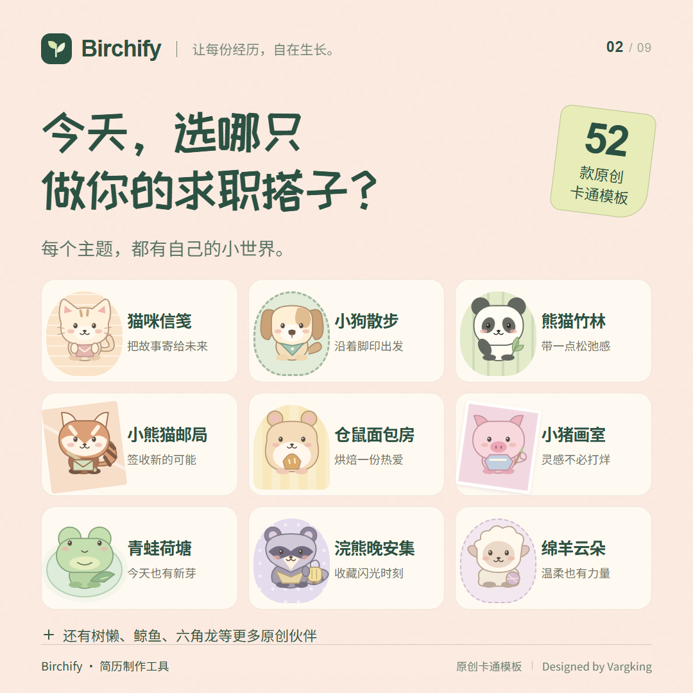
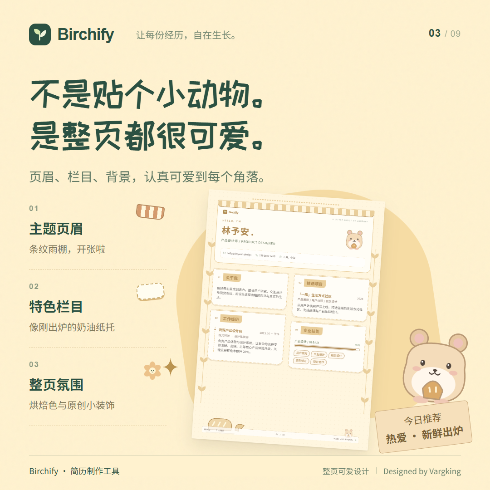
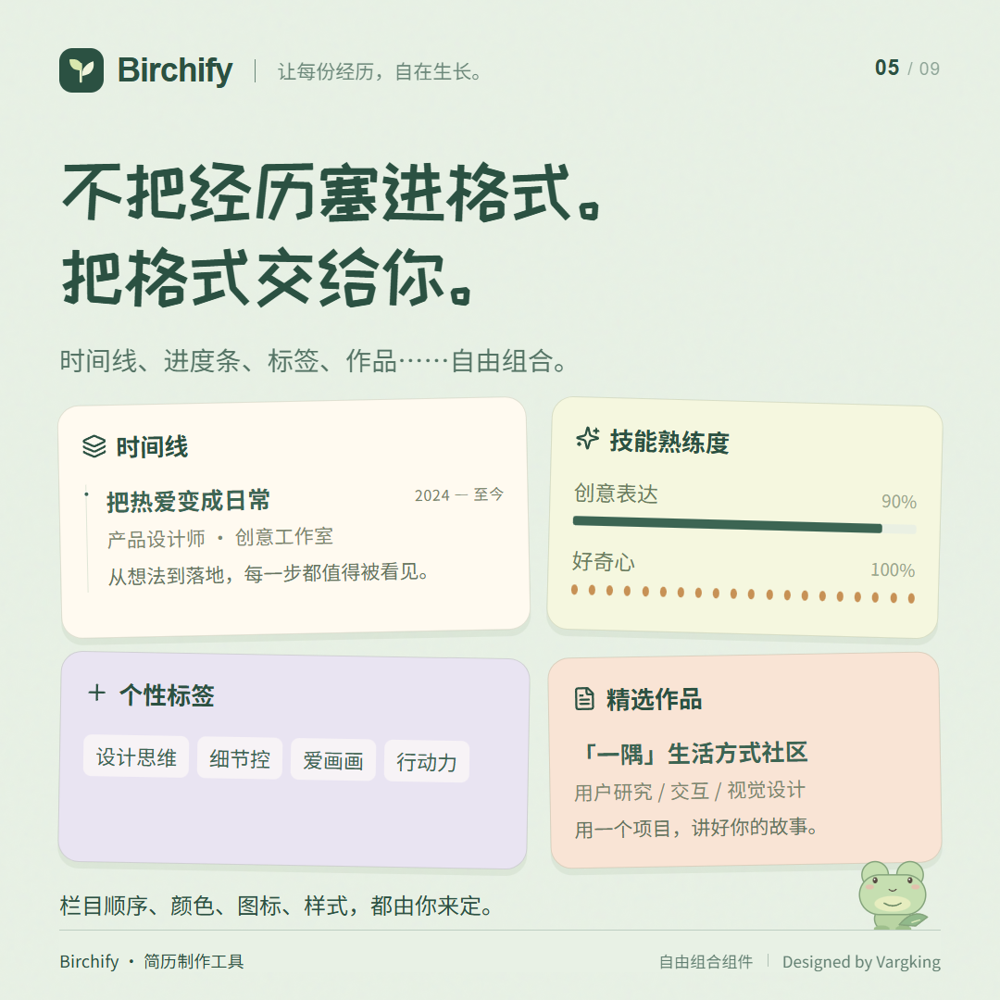
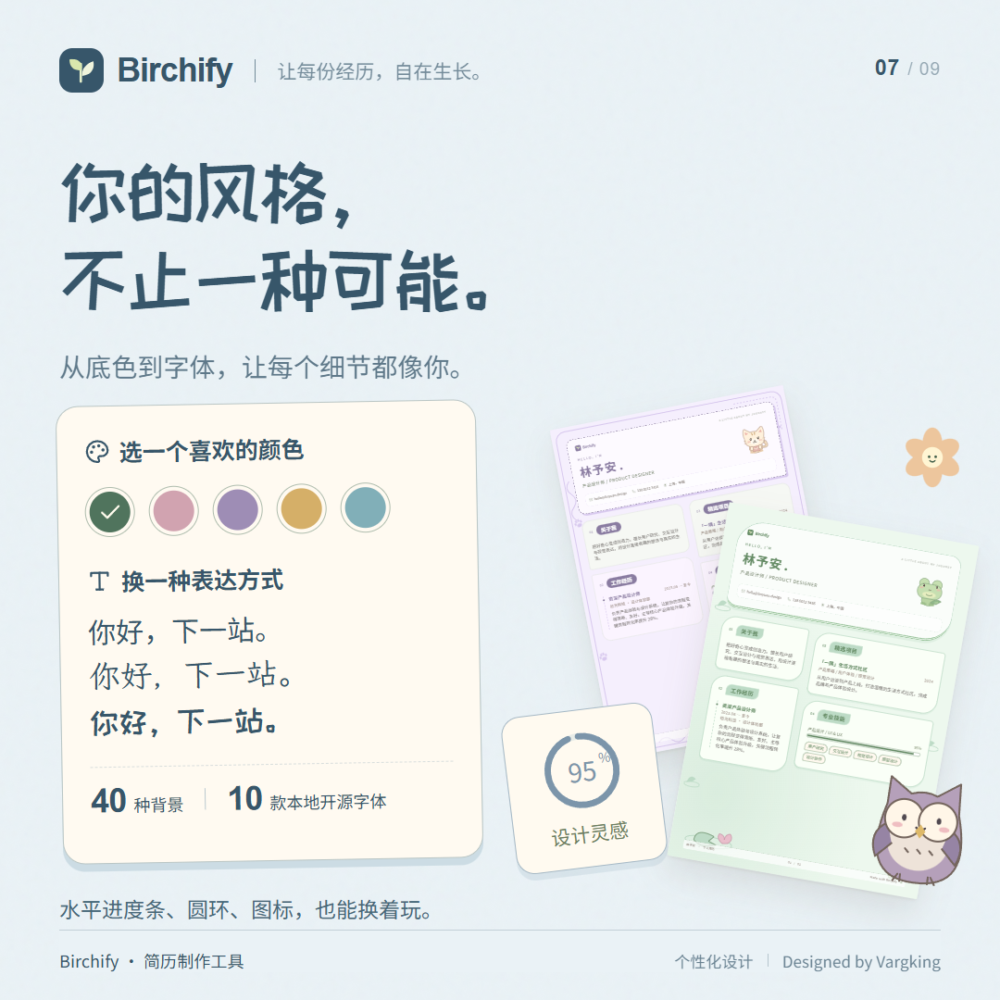
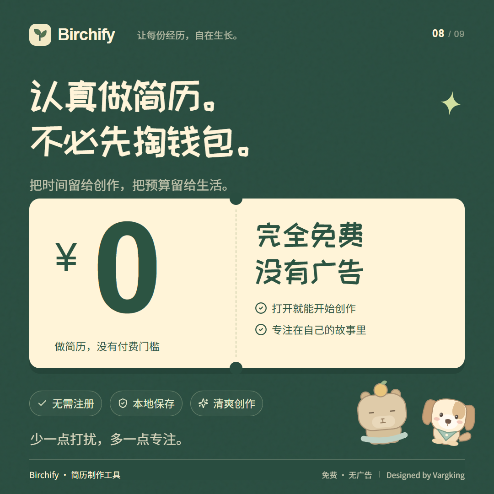
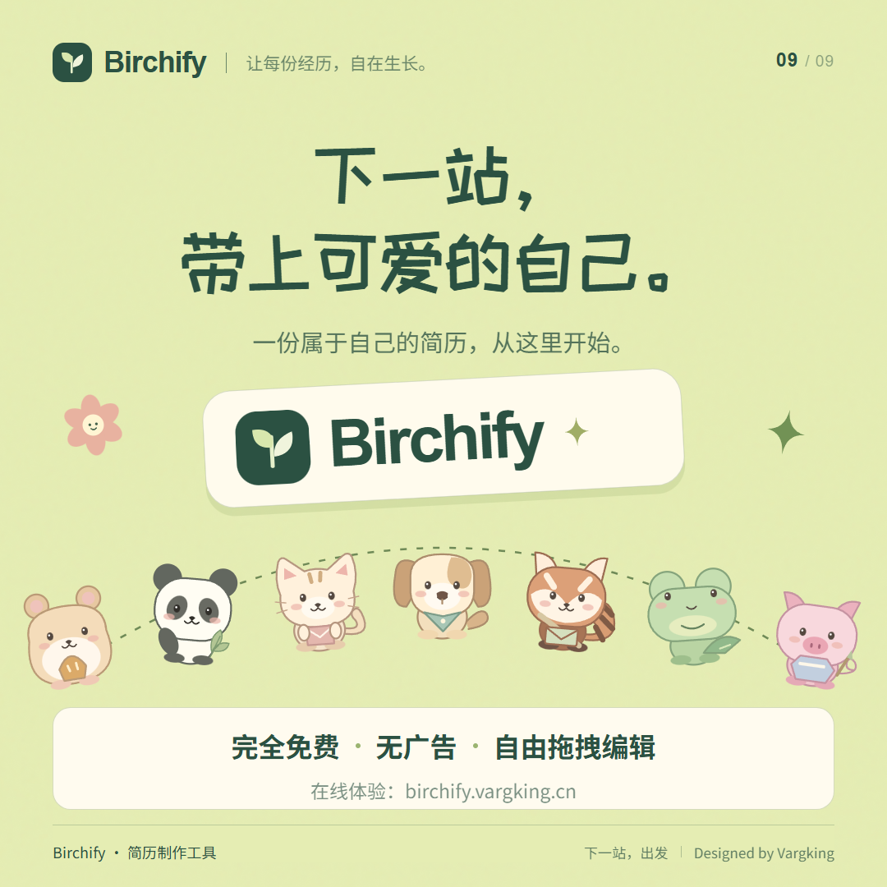

<div align="center">
  
  <h1>Birchify</h1>
  <p><strong>简历，也可以可爱得很认真。</strong></p>
  <p>原创卡通模板 · 自由拖拽编辑 · 完全免费 · 无广告</p>
  <p><a href="https://birchify.vargking.cn"><strong>在线体验 ↗</strong></a> · <a href="https://github.com/Vargking/Birchify">GitHub 开源仓库</a></p>
  <p>由 <a href="https://github.com/Vargking">Vargking</a> 打造的本地优先简历制作工具</p>
</div>

Birchify 是一款无需注册、无需后端的简历制作 Web App。从清爽专业的求职简历，到整页卡通化的个性履历，你可以自由组合内容、拖拽调整排版，再导出分享。所有编辑与导出都在浏览器中完成。

在线使用：**[birchify.vargking.cn](https://birchify.vargking.cn)**

## 产品展示

从原创卡通模板到实时拖拽编辑，看看一份简历可以有多少种可能。

















以上宣传图由代码绘制，复用项目中的原创 SVG 角色、Logo 和真实简历组件。完整图片与可重新生成的源码见 [img/](img/)。

## 不止是换个颜色

- **104 款模板与空白画布**：简约、专业、创意与卡通多种方向；其中 52 款原创卡通模板各有主题页眉、栏目设计、纸张氛围和场景装饰。
- **排版跟着你走**：组件和整个栏目都能拖拽排序，预览实时跟随；点击内容即可弹窗编辑。支持组件跨栏目移动与横向缩进调整。
- **内容自由组合**：文本、时间线、熟练度、标签、项目、链接、图片、引言、分隔线、留白共 10 类组件，可调整样式、颜色、字号、对齐、宽度、缩进与间距。
- **把细节变成自己的风格**：40 种背景、103 款组件图标、10 款本地开源中文字体，以及可自定义形状的个人照片。
- **电脑与手机都能用**：桌面双栏编辑与预览，移动端底部导航、双指缩放与放大后平移。精细排版推荐电脑，临时修改也可以在手机完成。
- **不止一页**：自动分页、跨页续栏和底部页码；支持清空、恢复示例内容、撤销与重做、浏览器自动保存和 JSON 备份迁移。

## 导出与备份

提供两种 PDF 导出方式。设计版支持文件名、品牌水印、页码、纸张背景、清晰度和页面范围设置。关闭品牌水印后，首页左上角的 Birchify Logo / 名称与页底品牌标识会一并移除。

| 格式 | 适合什么 | 需要了解 |
| --- | --- | --- |
| 设计版 PDF | 保留模板外观、分享与打印 | 图像型页面，保留照片、图标、进度条与整页装饰；文字不可选取，不建议用于 ATS 解析 |
| ATS 友好 PDF | 招聘系统上传、文字检索与提取 | 真实文字、内嵌中文字体、黑字白底单栏；按内容顺序重新分页，不保留模板外观 |
| JSON | 备份、迁移设备、继续创作 | 导入 Birchify 后可继续编辑全部内容 |

ATS 友好 PDF 按当前栏目、组件顺序导出全部可见内容，隐藏栏目不导出；不沿用预览的分页与当前页范围。保留联系方式、经历、日期和可点击链接，技能进度转为百分比，标签转为文字，图片组件只保留文字说明。照片、图标、装饰背景、品牌水印与页脚不导出，原简历和设计版设置不受影响。图片中的重要信息请补充为文字；字体不支持的生僻字或表情会明确提示，不会静默丢失。

ATS 友好不代表保证通过所有招聘系统：各系统的解析规则不同，投递前请核对导出内容及平台预览。需要继续修改完整简历，请使用 JSON 备份。

## 本地优先，数据留在浏览器

Birchify 不设置账号、广告、云同步或统计服务。简历与照片保存在当前浏览器的 `localStorage` 中，不上传至应用服务器；导出也由浏览器完成。

浏览器存储并不等于永久备份。清除站点数据、使用隐私模式、更换浏览器或访问域名，都可能使原有简历不可用；存储空间也有容量限制。建议定期下载 JSON 备份，尤其是在迁移设备或上传较大照片之前。

## 开发与自托管

项目基于 React、TypeScript 和 Vite，建议使用 Node.js 22 LTS 与 npm。

```sh
npm ci
npm run dev
```

```sh
npm run build
npm run preview
```

生产构建输出到 `dist/`，可托管于 GitHub Pages、Cloudflare Pages、Vercel 或其他静态站点服务，无需 Node.js 后端。

仓库已提供 [GitHub Pages 自动部署工作流](.github/workflows/deploy.yml)：在仓库 **Settings → Pages** 中选择 **GitHub Actions** 作为发布源，推送到 `main` 后自动构建与发布。工作流根据 Pages 配置设置仓库子路径；其他静态托管服务的构建命令为 `npm run build`，输出目录为 `dist`。

依赖安装默认使用 npmmirror 镜像。字体、图标和插画均随站点提供，应用运行时不依赖外部 CDN 或在线接口。设计版 PDF 使用 html2canvas / jsPDF；ATS 友好 PDF 使用 jsPDF 原生文字与本地开源 TrueType 字体。图标来自 Lucide 与项目原创 SVG。

## 参与改进

欢迎通过 Issue 反馈问题或提交 Pull Request。反馈排版和导出问题时，请提供浏览器、屏幕尺寸、模板名称与复现步骤；分享截图或 JSON 文件前，请移除个人信息。

自动化测试使用 Playwright，启动开发服务后运行 `npm test`。当前 [测试配置](playwright.config.ts) 使用 Windows 上的 Microsoft Edge，在其他环境运行时需调整浏览器路径。

## 许可证与致谢

代码采用 [MIT 许可证](LICENSE)，Copyright © 2026 Vargking。

原创角色与场景由代码绘制，不使用知名 IP 形象。第三方依赖遵循各自许可证；随站点分发的 10 款中文字体采用 SIL Open Font License 1.1，版权与许可声明见 [字体许可证](public/font-licenses.txt)。ATS 导出的 Birchify ATS 字体由 Noto Sans SC 子集整合而成，同样遵循 OFL，详见 [字体说明](public/fonts/README.md)。
